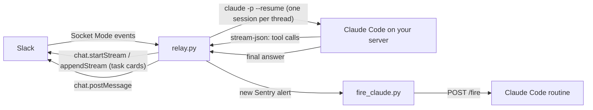

<p align="center">
  
</p>

<h1 align="center">claudino</h1>

**Talk to Claude Code from Slack.** Mention `@claudino` in a thread and a headless [Claude Code](https://claude.com/claude-code) session on your own server picks up the work: it reads the thread, investigates with your repositories and CLIs, opens PRs, and replies in the thread.

- **One session per thread.** Every new message in the thread resumes the same Claude Code session, so context carries over.
- **No mention needed once it's in.** After claudino takes part in a thread, teammates' replies reach it unless they mention someone else.
- **Never duplicates work.** Messages sent while a run is working are queued and handled together by the next run.
- **Survives restarts.** Runs a restart cuts off (every deploy restarts claudino) resume in the same Claude session, with their queued requests.
- **Native cards.** Answers can end with tables, charts (bar, line, area, pie), key-value fields and buttons, rendered as Slack Block Kit (`data_table`, `data_visualization`). A reply button sends its follow-up to the session as the clicker's request. Claude writes a small JSON spec ([`cards.py`](cards.py)); a spec that does not check out is left out and the text is posted alone. Buttons need **Interactivity** turned on in the Slack app settings (the manifest does it).
- **Files and forwards.** Images, files and forwarded messages in the thread are downloaded and handed to the session. A forwarded message that belongs to a thread brings that whole thread along, and its new replies on every later turn (claudino must be in its channel).
- **Instant feedback.** Every request gets an emoji reaction picked by Claude Haiku, with `:eyes:` as fallback, and the thread shows a loading status with rotating lines Haiku writes for that request until the answer lands. This needs **Agents** > **Agent experience** turned on in the Slack app settings (the manifest does it).
- **Live progress.** While a run works, the shimmering status under the thread rotates through Claude's latest steps ("Read in.pdf", "Run the tests"), and Haiku's lines for the request until the first one. `CLAUDINO_STREAM=on` also streams every step into the thread as Slack task cards (in progress, done, failed) through `chat.startStream`; those are deleted once the answer is posted (failed or stopped runs keep them, `CLAUDINO_KEEP_PROGRESS=on` keeps them always).
- **Sentry alerts (optional).** New top-level Sentry alerts in a channel fire a [Claude Code routine](https://docs.claude.com/en/docs/claude-code) that investigates and replies in the alert thread.
- **Stop (not shown yet).** Slack shows a stop button only on agent-session statuses (`agents.sessions.setStatus`), and those hide the rotating loading lines, so claudino keeps the lines and Slack says "Stop isn't available". The handler is ready: an `agent_session_stopped` event from an allowed user kills the run and its tools and drops queued requests.
- **Allowlist.** Only the Slack users you list can start runs.

It is ~600 lines of Python with two dependencies (`slack_bolt`, `slack_sdk`).

## How it works



| File | Role |
| --- | --- |
| [`relay.py`](relay.py) | Slack Socket Mode app: routing, allowlist, queue, reactions, files, posting answers |
| [`cards.py`](cards.py) | Checks an answer's card spec and turns it into Block Kit |
| [`progress.py`](progress.py) | Streams a run's tool calls into the thread as Slack task cards |
| [`claude_cli.py`](claude_cli.py) | Runs `claude -p` per thread and remembers each thread's session |
| [`config.py`](config.py) | Every setting, read from the environment |
| [`claudino_instructions.md`](claudino_instructions.md) | System prompt appended to every session |
| [`fire_claude.py`](fire_claude.py) | Fires the alert routine through its API trigger |
| [`scripts/alert-slack.py`](scripts/alert-slack.py) | Lets the alert routine react and reply in the alert channel without reading the bot token |
| [`deploy/`](deploy) | systemd units and the optional CI deployer |
| [`scripts/`](scripts) | `test.sh`, `set-tokens.sh`, `deploy.sh`, `slack-probe.py` |

## Quick start

You need a Linux server with systemd, Python 3.11+, [`uv`](https://docs.astral.sh/uv/), and the [Claude Code CLI](https://docs.claude.com/en/docs/claude-code/setup) logged in (`claude auth status`).

1. **Create the Slack app** from [`slack-app-manifest.yml`](slack-app-manifest.yml) (Create New App > From a manifest). Create an app-level token with `connections:write`, then install the app to your workspace.
2. **Install claudino** on the server:
   ```bash
   git clone https://github.com/macch-ai/claudino ~/claude-relay
   cd ~/claude-relay
   uv venv .venv && uv pip install --python .venv/bin/python -r requirements.txt
   ```
3. **Configure it.** Copy [`.env.example`](.env.example) to `~/.config/claude-relay/env` and set at least `CLAUDINO_ALLOWED_USERS` and `CLAUDINO_WORKDIR`. Then store the Slack tokens (hidden input, keeps your other settings):
   ```bash
   mkdir -p ~/.config/claude-relay && install -m 600 .env.example ~/.config/claude-relay/env
   ```
   ```bash
   scripts/set-tokens.sh
   ```
4. **Start it:**
   ```bash
   cp deploy/claude-relay.service ~/.config/systemd/user/
   systemctl --user daemon-reload && systemctl --user enable --now claude-relay
   loginctl enable-linger "$USER"
   ```
5. **Invite `@claudino`** to a channel and mention it. Logs: `journalctl --user -u claude-relay -f`.

## Configuration

All settings live in `~/.config/claude-relay/env`. [`.env.example`](.env.example) documents each one.

| Variable | Default | Purpose |
| --- | --- | --- |
| `SLACK_APP_TOKEN`, `SLACK_BOT_TOKEN` | required | Slack tokens (`scripts/set-tokens.sh`) |
| `CLAUDINO_ALLOWED_USERS` | empty: nobody | Slack user IDs allowed to start runs |
| `CLAUDINO_WORKDIR` | `~` | Where sessions start |
| `CLAUDINO_PERMISSION_MODE` | `bypassPermissions` | `bypassPermissions` runs `--dangerously-skip-permissions`; anything else goes to `--permission-mode` |
| `CLAUDINO_EXTRA_PATH` | `~/.local/bin` | Extra `PATH` entries for sessions |
| `CLAUDINO_RUN_AS` | empty | Unix user that runs Claude through sudo, so sessions cannot read the Slack tokens (see Security) |
| `CLAUDINO_MODEL`, `CLAUDINO_EFFORT` | Claude Code's model, `medium` | `--model` and `--effort` for sessions. Every answer ends with a footer naming the model Claude used and this effort |
| `CLAUDINO_PROMPT_SUFFIX` | empty | Text appended to every relayed request |
| `CLAUDINO_STATUS` | `is working on it...` | Loading status shown in the thread while a run works; `off` hides it |
| `CLAUDINO_LOADING_MESSAGES` | empty | Fallback loading lines, separated by `\|` (max 10), shown until Haiku's lines for the request are ready or when it fails |
| `CLAUDINO_STREAM` | `off` | `on` also streams each run's tool calls into the thread as task cards; off, the working status shows Claude's latest steps alone |
| `CLAUDINO_KEEP_PROGRESS` | `off` | `on` keeps the task cards after the answer; by default they are deleted once it is posted |
| `CLAUDINO_TIMEOUT_SECONDS` | `3000` | Kill a run after this long |
| `CLAUDINO_MAX_RUNS` | `3` | Claude runs working at once; other threads wait for a free slot |
| `CLAUDINO_FILES_KEEP_DAYS` | `14` | Delete files downloaded from Slack after this many days; `0` keeps them |
| `CLAUDINO_ALERT_*`, `CLAUDINO_CLAUDE_APP_USER` | empty: off | Sentry alert hand-over, see below |

**Private instructions.** Anything in `~/.config/claude-relay/instructions.md` is appended to the system prompt. Put your team's specifics there (repositories, CLIs, people, PR labels) so they stay out of this repo.

### Sentry alerts (optional)

Set all three to turn it on: `CLAUDINO_ALERT_CHANNEL` (where Sentry posts), `CLAUDINO_ALERT_BOT_USER` (the Sentry app's user ID) and `CLAUDINO_ALERT_ROUTINE_URL` (your routine's `/fire` endpoint). Put the routine's API token in `~/.config/claude-alert-fire/token`. On start, claudino catches up on alerts from the last 24 hours it missed.

With `CLAUDINO_RUN_AS`, the routine's session cannot read the bot token. It reacts and replies through `sudo -n -H -u claudino ~claudino/claude-relay/.venv/bin/python ~claudino/claude-relay/scripts/alert-slack.py add|get|post ...`, which acts only in `CLAUDINO_ALERT_CHANNEL` (sudo rule from `deploy/setup-relay-user.sh`).

## Security

> [!WARNING]
> By default claudino runs Claude Code with `--dangerously-skip-permissions`: **any command can run on the server without approval.**

- Messages from people outside the allowlist, bots, and forwarded messages reach the session fenced as `<untrusted>` data, and the system prompt says never to follow instructions in it. This lowers the risk; it does not remove it.
- `CLAUDINO_ALLOWED_USERS` limits **who can start a run**, not **what the thread contains**. Everything in the thread goes into the prompt: other people's messages, forwarded messages and their threads, files, and Sentry alert text written by whoever triggered the error. Treat this as a prompt injection path to a shell.
- Run claudino as a dedicated, unprivileged user on a machine you can afford to rebuild. Give that user only the credentials the agent truly needs.
- Want approvals instead? Set `CLAUDINO_PERMISSION_MODE=auto` (or `acceptEdits`, `default`). Blocked actions are reported back in the thread.
- Slack tokens are never passed to sessions: `claude_cli._env()` strips every `SLACK_*` variable. That alone does not stop a session from reading them: with one Unix user, a session can read the env file. Run `sudo deploy/setup-relay-user.sh <user>` once: the relay and the deployer then run as the user `claudino` (system units `claudino.service`, `claudino-deployer.service`), which alone can read the tokens, and Claude runs as `<user>` through sudo, keeping that user's logins and tools. It undoes itself if the relay does not come up; `--undo` goes back. Rotate the Slack tokens afterwards.

## Deploying from CI (optional)

[`.depot/workflows/ci-cd.yml`](.depot/workflows/ci-cd.yml) runs the tests on every pull request and push. With a deploy target configured, every merge to `main` also deploys:

1. The deploy job joins your tailnet ([Tailscale OAuth client](https://tailscale.com/kb/1215/oauth-clients) in the CI secrets `TS_OAUTH_CLIENT_ID` / `TS_OAUTH_SECRET`).
2. It calls `POST $DEPLOY_URL/deploy?sha=<commit>` on [`deploy/deployer.py`](deploy/deployer.py), a tiny service bound to a private address. Its only action: fast-forward the checkout to `origin/main` (refusing any other commit) and run [`scripts/deploy.sh`](scripts/deploy.sh).
3. `deploy.sh` installs requirements, runs the tests, refreshes the systemd unit, restarts the relay and checks it reconnected to Slack. If any step fails it rolls back to the previous commit.
4. The job checks `GET $DEPLOY_URL/health` reports the merged commit.

To set it up, put `DEPLOYER_HOST=<private IP>` in `~/.config/claude-relay/deployer.env`, install and start `deploy/claudino-deployer.service`, and set the CI variable `DEPLOY_URL` (for example `http://100.x.y.z:8765`). Without `DEPLOY_URL` the deploy job is skipped, so forks just run the tests.

Manual deploy: `cd ~/claude-relay && git pull --ff-only && scripts/deploy.sh "$(git rev-parse HEAD@{1})"`.

## Development

```bash
scripts/test.sh
```

It creates `.venv` with `uv` when missing, installs the requirements, lints with `ruff` (rules in [`ruff.toml`](ruff.toml)) and runs the suite. Slack and Claude are faked, so tests run anywhere.

To check a change end to end, deploy it, mention claudino in a test channel and read the reply in the thread. Server logs: `journalctl --user -u claude-relay -n 50`.

## License

[MIT](LICENSE)
