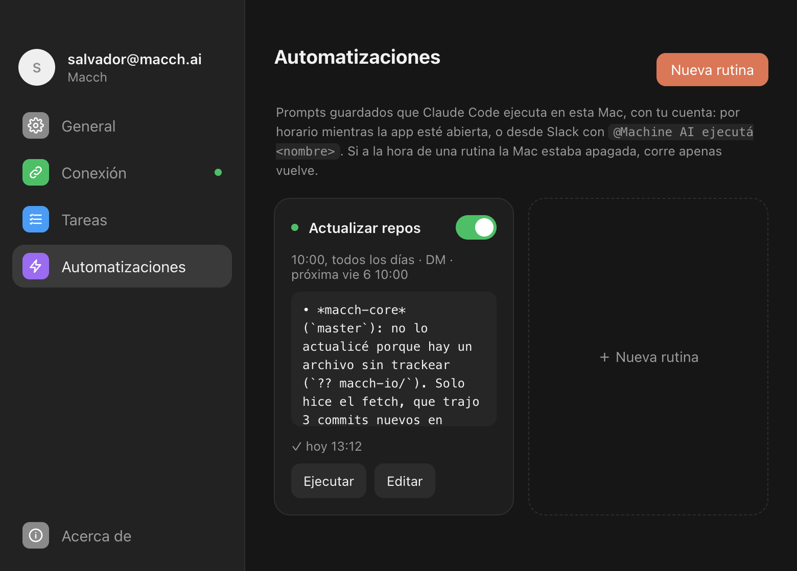

# Machine AI: requests on each teammate's Mac

Machine AI is a second Slack agent built from this repository. claudino runs on one server. Machine AI runs each request on the **requester's own Mac**, through a Cloudflare Worker (`worker/`) and the **MACCH Agent** menu bar app (`desktop/`), with that teammate's Claude login. It uses no shared account and no API key.

## Pieces

- **Worker** (`worker/`, Cloudflare Workers Free plan):
  - Receives Slack events over HTTP (`/slack/events`, signed).
  - Routes each request to the first requester's Mac.
  - Durable Objects:
    - per teammate (`UserDO`): the Mac's hibernating WebSocket, its token and its queued threads;
    - per thread (`ThreadDO`): one run at a time, later requests queued, retry once with a fresh session;
    - one for pairing (`PairingDO`).
  - If a Mac is off, its threads wait and run when it reconnects. Runs never go to another teammate's Mac.
  - Slack files reach the Mac through `/files/:id`, so the bot token stays in Cloudflare.
  - The system prompt is `machine_ai_instructions.md`.
- **MACCH Agent** (`desktop/`, Electron):
  - Links with "Iniciar sesión con Slack" (Sign in with Slack in the browser) or `@Machine AI vincular <code>`.
  - Runs `claude -p` locally, with `ANTHROPIC_API_KEY` dropped so it never bills an API key.
  - Picks the reaction emoji with Haiku.
  - Runs **automations**: daily, every N minutes, or `@Machine AI ejecutá <name>`. The result goes by DM and, optionally, to a channel. A run missed while the Mac was off runs when it reconnects.
  - Themes: system, light, dark and retro.
  - State lives in `~/.config/claudino/`.

## Delegating to claudino

When Machine AI's answer mentions claudino (`AGENT_USER_ID`), the thread waits for claudino. claudino's reply, which mentions Machine AI and comes from `AGENT_APP_ID`, continues the original request on the requester's Mac, and Machine AI then answers the teammate with the result. A thread handles at most 3 agent replies per human message.

On claudino's side, set `CLAUDINO_TRUSTED_AGENT_APPS` to Machine AI's app ID, so claudino accepts Machine AI's explicit mentions.

## Run and deploy

- App: `cd desktop && npm install && npm start`. It needs Node 22+, and `claude auth status` must say `claude.ai`.
- Package the app: `npm run package` writes `out/MACCH Agent-darwin-arm64/MACCH Agent.app`. Copy it to `/Applications`.
- Dev aids:
  - `CLAUDINO_HUB_URL` points the app at another Worker.
  - `CLAUDINO_SCREENSHOT=/path.png` saves a capture of the window. Pick the page and theme with `CLAUDINO_SCREENSHOT_PAGE` and `CLAUDINO_SCREENSHOT_THEME`.
- Worker:
  - Unit tests: `cd worker && npm install && npm test`.
  - Local run: `npx wrangler dev` (secrets in `worker/.dev.vars`).
  - Deploy: `npx wrangler deploy`.

## Setup (once)

1. Run `npx wrangler login`, then `cd worker && npx wrangler deploy`. Keep `DEFAULT_URL` in `desktop/src/hub.ts` in sync with the URL it prints.
2. Set the secrets with `npx wrangler secret put`: `SLACK_BOT_TOKEN`, `SLACK_SIGNING_SECRET`, `SLACK_CLIENT_ID`, `SLACK_CLIENT_SECRET`, and `ROUTINE_TOKEN` (optional, for Sentry alerts).
3. In Machine AI's Slack app:
   - **OAuth & Permissions:** add the redirect URL `<worker URL>/login/callback` and the user scopes `openid` and `profile`.
   - **Event Subscriptions:** set the Request URL to `<worker URL>/slack/events`, with the bot event `message.channels`.
   - **Socket Mode:** off.
4. Each teammate installs MACCH Agent and links it.

